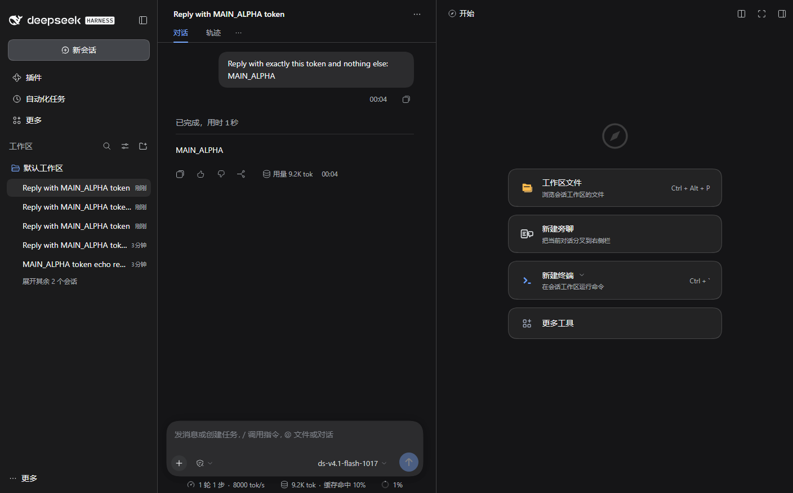
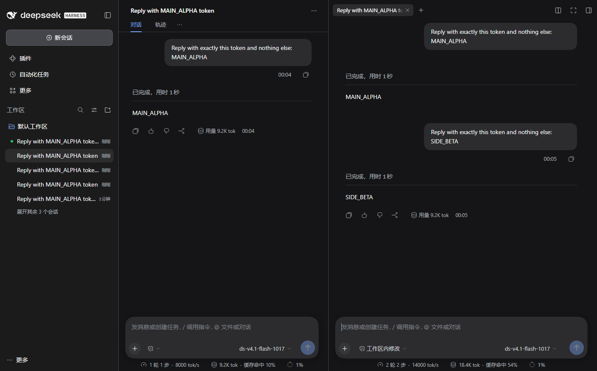

# Aside (旁白)

[中文](README.zh.md) | English

A **forked side chat in the right sidebar** for [DeepSeek Harness](https://github.com/deepseek-ai/deepseek-harness).

Open a branch of the conversation you are in, right next to the terminal, keep talking
in it, ask it questions — and leave the main thread completely untouched. It is the same
idea as Codex's side chat, except the side chat is a **first-class sidebar tab**: it
docks, splits, floats and goes fullscreen exactly like the terminal tab does.





## What you get

- **新建旁聊** — a new card in the right sidebar's start page, right above **新建终端**.
  Clicking it forks the current conversation into a new tab.
- **A real fork, not a copy-paste.** The tab is a real child session whose history was
  copied from the main thread up to the last completed turn. It has its own model, its
  own tools, its own composer and its own transcript.
- **Talk to it freely.** Ask it anything, steer it, stop it. Nothing you type there ever
  appears in the main thread, and the main thread's next turn is unaffected.
- **It survives reloads and restarts.** The tab is stored with the sidebar layout and
  re-attaches to the same child session when you come back.
- **As many as you want.** Each one is an independent session.
- **Zero model surface.** Aside registers no tool, no prompt section and no command.
  It costs no tokens until you open a side chat, and it changes nothing about how the
  main agent behaves.

## Install

Aside ships as a DSH profile bundle. From a checkout of this repository:

```powershell
dsh plugin --profile web add C:\path\to\dsh-plugin-aside
```

Then restart DSH Desktop (a replaced package needs a fresh JavaScript module generation)
and open any conversation. Expand the right sidebar — the card is on the start page.

> A profile-installed local directory is a `link:` dependency, so after editing the
> plugin's source you must restart DSH again; a browser refresh is not enough.

The plugin needs DSH `>= 0.2.1-rc.5` (the version that exposes `ctx.sessions.fork` and
the `sidebar.chat.conversation` seat on the Web client). It has no runtime dependencies
and uses only APIs the shipped Web client already provides.

## How it works

Three registrations, all in the browser half:

1. A `dsh-resource://asidechat/session/<child>?parent=<parent>` resource provider that
   retains the child session's `SessionReference` for exactly as long as a tab holds the
   address, and releases it when the tab closes.
2. The `asidechat` sidebar tab type plus the **新建旁聊** start-page card. Clicking the
   card calls `ctx.sessions.fork({ sessionId, increaseTitle: true })` — the same client
   API the chat's own "branch from here" action uses — and then opens the resulting
   child in the sidebar.
3. The tab body, which binds the retained reference through `SessionProvider` and renders
   the shared `conversation.content` factory in its `embedded` variant with the Chat view
   pinned. The transcript, composer, queue and attachments are the native ones; Aside
   only supplies the address and the placement.

The host half (`index.js`) is intentionally inert: a bundle row has to resolve to a
Cordis plugin, but there is nothing to register on the host. That is why the plugin adds
no tools and no prompt text. See [DESIGN.md](DESIGN.md) for the full rationale and the
API contract each step depends on.

## Shortcut

`Ctrl/Cmd + Shift + \`` forks the conversation on screen into a new side chat. Rebind it
under Settings → Shortcuts (its id is `aside.new`).

## Limits worth knowing

- **A fork needs a finished turn.** The first message of a brand-new conversation has to
  finish before there is anything to fork; the card says so instead of failing silently.
- **A side chat is a normal session.** It appears in the left session list too — that is
  deliberate, because it means you can reopen it in the main pane later. Close the tab to
  drop it from the sidebar; the session itself stays until you delete it.
- **The tab title follows the fork.** It is captured from the session when the tab opens
  and kept live afterwards, so renaming the child updates the chip.
- **There is no host-side switch.** A host config could not change browser behaviour, and
  a switch that lies is worse than none, so Aside has no config block.

## Verified

Everything below was exercised against a real DSH Web instance (a live model answering),
not mocked. The unit suite covers the bundle itself; the browser scenario covers the
integration.

| Claim | How it was checked |
|---|---|
| The card sits next to 新建终端 | start page rendered `工作区文件`, `新建旁聊`, `新建终端` |
| Clicking it forks the conversation | tab mounted with a child session id distinct from the parent |
| The child inherits the main history | side transcript contains the main thread's tokens |
| The side chat answers on its own | a prompt sent in the side chat produced its own reply |
| The main thread is untouched | main transcript never contained the side prompt |
| A reload restores the same side chat | same child id and same turn after `Page.reload` |
| A second side chat is independent | a second tab opened as a different child session |

## Development

```powershell
node --test "test/**/*.test.mjs"   # unit tests, no dependencies
node --check index.js; node --check client.js
```

The unit suite loads the real `client.js` through a stubbed module loader and a recording
Cordis context, so the assertions run against the shipped bundle rather than a copy of its
logic.

## License

[AGPL-3.0-or-later](LICENSE).
