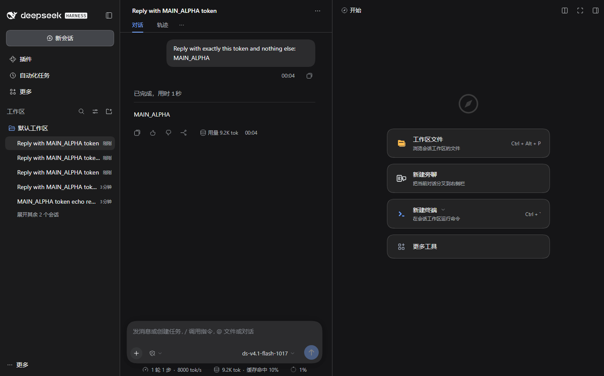
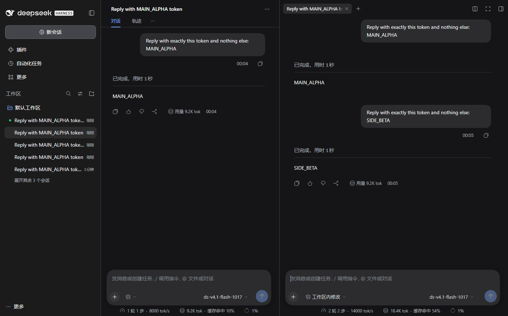

# Aside（旁白）

中文 | [English](README.md)

给 [DeepSeek Harness](https://github.com/deepseek-ai/deepseek-harness) 的**右侧栏分叉侧聊**。

把你正在聊的对话分叉一份到右侧栏，就在终端旁边：在分支里继续聊、向它提问，主线程完全不受影响。
思路和 Codex 的 side chat 一样，但侧聊是**右侧栏的一等公民标签**——和终端标签一样能停靠、分栏、
浮窗、全屏。





## 能得到什么

- **新建旁聊**——右侧栏开始页新增的卡片，就在 **新建终端** 上方。点它把当前对话分叉成一个新标签。
- **真分叉，不是复制粘贴。** 那个标签是一个真实子会话，历史来自主线程最后一个已完成轮次。它有自己
  的模型、自己的工具、自己的输入框和自己的 transcript。
- **随便聊。** 提问、插话、停止都行。侧聊里输入的任何东西都不会出现在主线程，也不会影响主线程的下
  一轮。
- **刷新和重启都不丢。** 标签跟着侧栏布局一起保存，回来时重新接上同一个子会话。
- **想要几个就开几个。** 每一个都是独立会话。
- **旁聊能反过来找主线程。** 它的 agent 多一个工具 `aside_tell_main`，能把消息投递进主对话——排在当前轮之后，或者打断当前轮。投递的那条带 `【来自旁聊】` 标记和 `agent-message` 来源，绝不会冒充你手打的话。在旁聊之外这个工具会拒绝执行，从不猜目标。
- **几乎不占模型面。** 只注册一个工具、不注入任何提示词；不调它就不产生开销，不开旁聊的对话完全不受影响。

## 安装

Aside 以 DSH profile bundle 形式发布。在本仓库检出目录下：

```powershell
dsh plugin --profile web add <本仓库的绝对路径>
```

然后**完全退出并重启 DSH Desktop**（换了包代码必须重载模块）。打开任意对话，展开右侧栏，卡片就在
开始页上。

> 本地目录安装是 `link:` 依赖，所以**改插件源码后也要重启 DSH**，刷新页面不够。

需要 DSH `>= 0.2.1-rc.5`（暴露 `ctx.sessions.fork` 与 Web 客户端 `sidebar.chat.conversation` 席位的
版本）。无运行时依赖，只用 Web 客户端本来就有的 API。

## 工作原理

三个注册，全在浏览器半侧：

1. 一个 `dsh-resource://asidechat/session/<child>?parent=<parent>` 资源 provider：标签持有地址期间
   保留子会话的 `SessionReference`，标签关闭即释放。
2. `asidechat` 侧栏标签类型 + **新建旁聊** 开始页卡片。点卡片时调用
   `ctx.sessions.fork({ sessionId, increaseTitle: true })`——就是对话里「从这里分叉」用的同一个客户端
   API——再把分叉出来的会话开进侧栏。
3. 标签正文：用 `SessionProvider` 绑定刚保留的 reference，再把共享的 `conversation.content` Factory
   以 `embedded` 变体、Chat 视图渲染出来。transcript、输入框、队列、附件全是原生实现，Aside 只提供
   地址和摆放位置。

宿主半侧（`index.js`）是**故意空**的：bundle 行必须解析成一个 Cordis 插件，但宿主侧没有任何东西要注册。
这也是它不产生工具与提示词的原因。完整理由与每一步依赖的 API 契约见 [DESIGN.md](DESIGN.md)。

## 快捷键

`Ctrl/Cmd + Shift + \`` 把屏幕上的对话分叉成新侧聊。可在「设置 → 快捷键」里改绑（id 是 `aside.new`）。

## 需要知道的限制

- **分叉需要已完成的轮次。** 全新对话的第一条消息得先跑完，否则没有可分叉的内容；卡片会明确提示，
  而不是静默失败。
- **侧聊就是一个普通会话。** 它同时会出现在左侧会话列表里——这是有意的，意味着你以后可以在主面板
  里重新打开它。关掉标签只是从侧栏移除，会话本身要在会话列表里删。
- **标签标题在打开时捕获**，之后跟随会话标题，所以重命名子会话会更新 chip。
- **没有宿主侧开关。** 宿主配置改变不了浏览器行为，而一个骗人的开关比没有更糟，所以 Aside 没有
  config 块。

## 已验证

下面每一条都是在真实 DSH Web 实例上跑出来的（真模型作答），不是 mock。单测覆盖 bundle 本身，浏览器
场景覆盖集成。

| 断言 | 验证方式 |
|---|---|
| 卡片就在 新建终端 旁边 | 开始页渲染出 `工作区文件`、`新建旁聊`、`新建终端` |
| 点击即分叉 | 标签挂载，子会话 id 与父会话不同 |
| 子会话继承主历史 | 侧聊 transcript 里出现主线程的 token |
| 侧聊能独立作答 | 在侧聊里发提示词，得到属于它自己的回答 |
| 主线程不受影响 | 主 transcript 里从未出现侧聊的提示词 |
| 刷新后仍是同一个侧聊 | `Page.reload` 后子会话 id 与轮次都在 |
| 第二个侧聊互相独立 | 第二个标签是另一个子会话 |

## 开发

```powershell
node --test "test/**/*.test.mjs"   # 零依赖单测
node --check index.js; node --check client.js
```

单测通过桩化的模块加载器与记录型 Cordis context **加载真实的 `client.js`**，所以断言打在发布产物上，
而不是逻辑的副本。

## 许可

[AGPL-3.0-or-later](LICENSE)。
